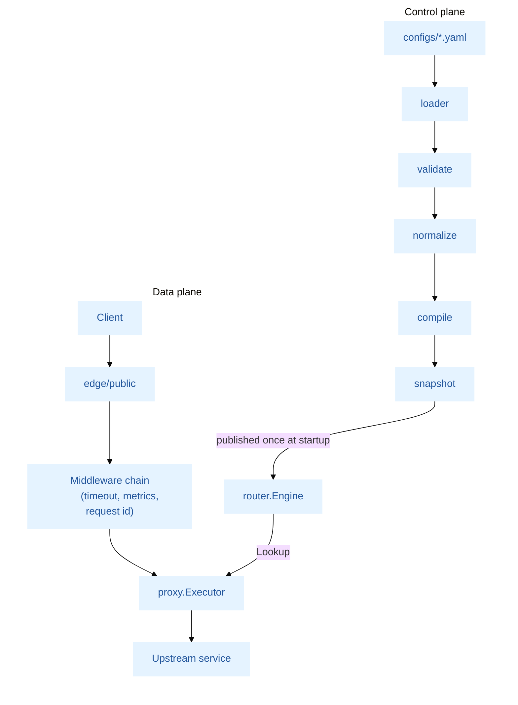
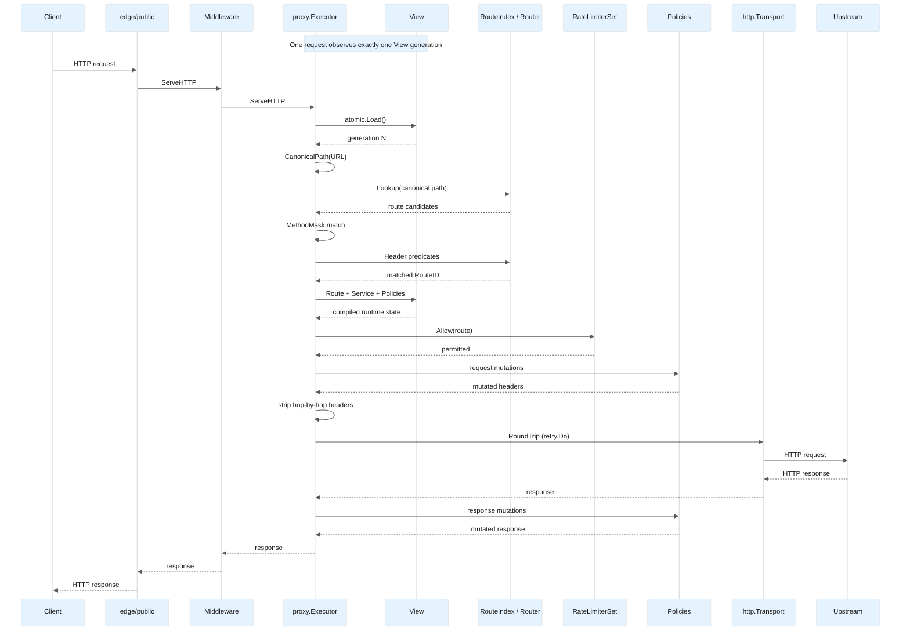
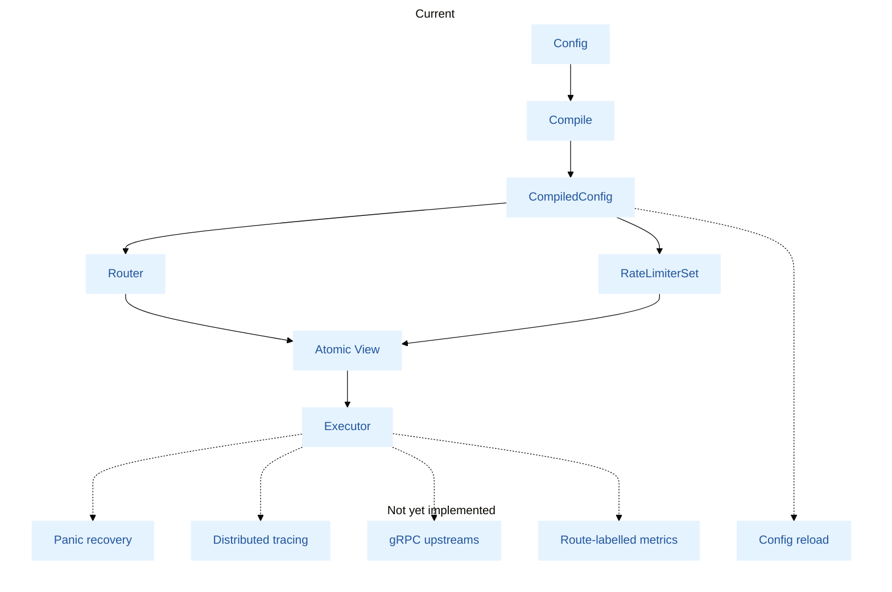

# Architecture

## Overview

Aegis is split into two planes with a hard boundary between them:

- **Control plane** — loads YAML configuration, validates it, normalizes it, and compiles it into an immutable snapshot. This runs once at startup and never on the request path; configuration reload is not supported.
- **Data plane** — serves live HTTP traffic against the compiled snapshot: route lookup, method/header matching, policy mutation, and proxying to upstream services.

The boundary exists so the hot path never re-derives behavior from raw configuration. Every request consults only precompiled, read-only structures — no YAML parsing, no validation, no config-shaped branching at request time. This is a statement about configuration, not about memory: route lookup is allocation-free, whereas building the outbound request allocates (see "Key design decisions").

## Request lifecycle

1. `edge/public` accepts the connection and forwards to the data plane's compiled `http.Handler`.
2. The middleware chain runs outermost first: **timeout**, **metrics**, and **request ID** (metrics and request ID can each be switched off with the `middleware` section of the runtime config; both are on by default). Request ID keeps a well-formed client `X-Request-ID` or generates a UUIDv7 and echoes it in the response. The route handler forwards the request to the executor. Panic recovery is not yet part of the chain (see Roadmap).
3. `proxy.Executor` loads the published `View` (answering `503` if none exists), canonicalizes the request path with `request.CanonicalPath` (answering `400` if it has no canonical form), and rejects methods outside the supported set with `405`. The canonical path is the one both routed and forwarded.
4. The executor looks the path up in the route index (`router.Engine.Lookup` over `snapshot.RouteIndex`). Lookup offers candidate sets in priority order (static, parameter, wildcard, then `path_prefix` fallbacks). Candidates are filtered by HTTP method using a precomputed bitmask (`internal/httpmethod`) and by header predicates (`router.HeadersMatch`). The first candidate satisfying both wins; if none does, the response is `404` or `405`.
5. The matched route's rate limiter is consulted once (`policy.RateLimiterSet.Allow`); a rejected request is answered `429` before any upstream attempt. The route's service `timeout`, if configured, then bounds the remainder of the exchange.
6. `request.UpstreamHeader` builds the outbound header, replacing the `X-Forwarded-*` headers with values derived from the connection. `policy.ExecuteMutations` applies the route's request-side header operations, and hop-by-hop headers are then stripped (`request.RemoveHopHeaders`).
7. `retry.Do` sends the request through the configured `http.RoundTripper`, repeating idempotent, body-less requests after transient failures when the service configures more than one attempt.
8. On success, response-side policy mutations are applied, hop-by-hop headers are stripped, the headers are copied to the client, and the body is streamed with `io.CopyBuffer` using a pooled buffer. A failure to obtain a response is answered `504` for a timeout and `502` otherwise.
9. Failure modes are explicit. Every status code the executor can return, and the condition that produces it, is listed in [docs/routing-and-errors.md](docs/routing-and-errors.md) §2.

The sequence below traces one request end to end, including where the atomically published `View` is read and which component performs each mutation.

## Key design decisions

**Radix trie routing, not a map.** Route lookup uses a compressed radix trie supporting static, `:param`, and `*wildcard` segments, matched with static > param > wildcard priority. The router benchmarks report **0 allocations per lookup** from 16 to 32,768 routes, and the tree stays shallow because of prefix compression, so lookup cost is governed chiefly by path depth and grows only slowly with route count. Insertion (setup-time only) favors correctness over allocation avoidance; lookup (request-time) is optimized for zero allocations, since it runs on every request. The guarantee covers `Lookup` only: the executor as a whole still allocates per request, for the outbound request, its header copy, and the retry and timeout contexts.

**Method matching via bitmask, not string comparison.** `internal/httpmethod` maps each HTTP method to a bit; route admission is a single `AND` against a precomputed mask instead of iterating and string-comparing allowed methods per request.

**Control/data plane separation.** Configuration compiles once into a `snapshot` package the data plane only reads. This means adding a route, a policy, or a service doesn't change data-plane code paths — it changes what the compiler produces, keeping the request-serving code free of configuration-shaped conditionals.

**Middleware as `func(http.Handler) http.Handler`.** Standard, composable Go idiom. The public server composes the chain in `internal/edge/public/server.go`, installing the optional layers according to `config.Runtime.Middleware`; the innermost handler forwards each request to the executor.

**Request ID: accepted when well-formed, otherwise a UUIDv7.** A client-supplied `X-Request-ID` is kept only when it is a single value of 1–128 visible ASCII characters, so a caller's ID can be followed end to end while spaces and control characters — the log-injection vector — never get through. Anything else is replaced with a UUIDv7, which is time-ordered and sorts naturally in logs, unlike UUIDv4. The ID is written into the request headers, which is how it reaches the upstream and later handlers without a `context.Context` allocation, and is echoed in the response.

**Atomically published `View`.** The routing engine and the rate limiters are bundled into one `proxy.View` and installed with a single `Executor.Publish`. A request loads the pointer once, so it observes exactly one generation of both. The `http.RoundTripper` is deliberately outside the `View`, because its connection pool must outlive any configuration. Only the initial publication exists today; the boundary is what allows reload to be added without redesigning the executor.

**Canonical path is the routing key and the forwarding key.** `request.CanonicalPath` resolves dot segments and merges empty segments, and the result is both matched against the index and sent upstream. A request therefore cannot be authorized by one route while addressing another resource.

**Separate system and public listeners.** Health and metrics are served on a distinct port (`:18080`) from user traffic (`:8080`), so operational endpoints are never reachable through the same routing/policy path as untrusted traffic. The shipped `configs/aegis.yaml` binds the system listener to `0.0.0.0`; production deployments should bind it to an internal interface (see [docs/runtime-configuration.md](docs/runtime-configuration.md) §4.3).

## Process lifecycle

`cmd/main.go` installs a signal context (`SIGINT`, `SIGTERM`) and calls `app.New` followed by `App.Run`.

1. **Construction (`app.New`).** Flags are parsed into a private `FlagSet`; each configuration path is resolved from its flag or environment variable. The runtime configuration is decoded over `config.DefaultRuntime()` and validated, and the routes manifest is loaded and validated by `controlplane/loader`. `Bootstrap` then compiles the manifest (`pipeline.Build`), builds the `router.Engine` and the rate limiters, creates the upstream transport, publishes the first `View`, and constructs both HTTP servers. No socket is opened at this stage; any error aborts startup.
2. **Serving (`App.Run`).** `Lifecycle` starts the public and system listeners under one `errgroup`. A failure of either listener, or cancellation of the signal context, triggers the single shutdown path.
3. **Shutdown.** `/readyz` starts answering `503`, then both listeners are shut down in parallel, each bounded by a fixed 15 s `shutdownTimeout`. In-flight requests are drained within that bound; when it elapses, the remaining connections are closed forcibly and `Run` returns an error. The timeout is a constant, not a configuration field. A clean, signal-driven shutdown returns `nil`.

The readiness flip and the listener shutdown happen back to back, with no grace period in between: a load balancer that polls `/readyz` only learns of the shutdown after the listeners have begun to close.

## Package layout

| Package | Responsibility |
|---|---|
| `internal/app` | Process wiring: dependency container, lifecycle, graceful shutdown |
| `internal/yamlx` | Strict YAML decoding shared by the runtime configuration and the routes manifest loader |
| `internal/config` | Runtime configuration: environment path resolution, defaults, validation |
| `internal/httpmethod` | HTTP method set and bitmask, shared by validation, the compiler, and the router |
| `internal/controlplane` | Load → validate → normalize → compile pipeline. Subpackages: `schema` (source model), `loader`, `validate`, `normalize`, `ir`, `compile`, `pipeline` |
| `internal/snapshot` | Immutable compiled data contract, including `RouteIndex` |
| `internal/dataplane/router` | `Engine` façade over the compiled snapshot; header predicate matching |
| `internal/dataplane/proxy` | `Executor`, the terminal handler that performs the upstream call |
| `internal/dataplane/policy` | Header mutation execution and rate limiting |
| `internal/dataplane/request` | Path canonicalization and hop-by-hop header handling |
| `internal/dataplane/retry` | Retries of idempotent upstream requests |
| `internal/dataplane/routelabel` | Context-carried recorder for the matched route's name. The executor writes to it; nothing creates or reads it yet (see Roadmap) |
| `internal/dataplane/middleware` | Request ID, metrics (method and status), and request-timeout middleware |
| `internal/edge` | Listener-facing HTTP servers: public traffic and admin endpoints |
| `internal/observe` | Health checks and Prometheus metrics registration |

## Dependency rules

The layering is enforced by the `depguard` linter, configured in [.golangci.yml](.golangci.yml) and run in CI by `make lint`. A violation fails the build; the rules below are the prose version of that file.

| Layer | May import | Must not import |
|---|---|---|
| `httpmethod` | standard library | everything else |
| `snapshot` | `httpmethod` | everything else |
| `yamlx` | `gopkg.in/yaml.v3` | other internal packages |
| `config` | `yamlx` | other internal packages |
| `observe` | `prometheus/client_golang` | other internal packages |
| `controlplane` | `snapshot`, `httpmethod`, its own subpackages | `dataplane`, `edge`, `observe`, `app`, and `config` |
| `dataplane` | `snapshot`, `httpmethod`, its own subpackages | `controlplane`, `edge`, `config`, `observe`, `app` |
| `edge` | `observe`, standard library, its own subpackages; transitionally `config` and `dataplane/middleware` (see below) | `controlplane`, other `dataplane` packages, `app` |
| `app` | everything (composition root) | — |

Nothing under `internal/` may import `internal/app`; only `cmd` and tests outside `internal/` do.

The leaf layers (first five rows, plus `edge`) use an allow-list, so a new import, including a new third-party module, fails until it is named in the config. The others use a deny-list of the layers they must not reach. Test files have their own rules: for example, data plane tests may build snapshots with `controlplane/compile`, and edge tests may create a Prometheus registry.

**Known violations.** Each is marked `TODO(arch)` in `.golangci.yml` and is allowed only until the step that removes it:

- `dataplane/middleware` imports `observe/metrics`, and `edge` imports `dataplane/middleware` and the whole of `config`; the middleware belongs to the edge.
- `snapshot` imports `golang.org/x/time/rate` because `CompiledRateLimit.Limit` is a `rate.Limit`.
- Data plane tests use `controlplane/compile` to build snapshots.

**Limits of the check.** `depguard` inspects direct imports only, which is sufficient here because every layer has a rule. A new top-level package under `internal/` is covered only by the rule that forbids importing `app`; give it a rule when you add it.

## Roadmap / known limitations

This is a pre-1.0 project. The following items are not implemented; they are deferred deliberately:

- **Panic recovery.** No recovery middleware is part of the public chain, so a panic in a handler is not converted to a 500 response.
- **Distributed tracing.** It requires an OpenTelemetry dependency, an exporter, and context propagation into the executor, which is not justified before the gateway has more than one hop worth tracing.
- **gRPC upstreams.** Not supported; the executor proxies HTTP only.
- **Configuration reload.** Not supported; changing routes requires a restart (see [docs/routing.md](docs/routing.md)).

The following gaps are narrower than the items above but equally real. Each is a defect or an incomplete feature in the current code, not a design decision:

- **Route-labelled metrics.** `aegis_http_requests_total` carries only `method` and `status`, and `aegis_http_request_duration_seconds` only `method`. The executor reports the matched route to `routelabel`, but no code creates a recorder (`routelabel.NewContext` has no caller) and the metrics middleware does not read one. The wiring described in `routing-and-errors.md` §2.2 is therefore inert.
- **Active-request gauge.** `aegis_http_active_requests` is registered but never incremented or decremented, so it always reads `0`.
- **Logging configuration.** `observability.logging` is validated but not applied; the process logs through the standard `log` package.
- **Trusted proxies.** `proxy.trusted_proxies` is decoded but unused; `X-Forwarded-For` is always replaced with the connection address.
- **Header policy on `Host`.** A `set` or `add` of `Host` in a request policy writes `Header["Host"]`, which `net/http` ignores when sending a request.

Request timeouts and request IDs are implemented and wired into the public server. Metrics are implemented without route labels, as described above.

The diagram below places these items against the implemented pipeline.

Config schemas and public interfaces may change before an initial stable release.
