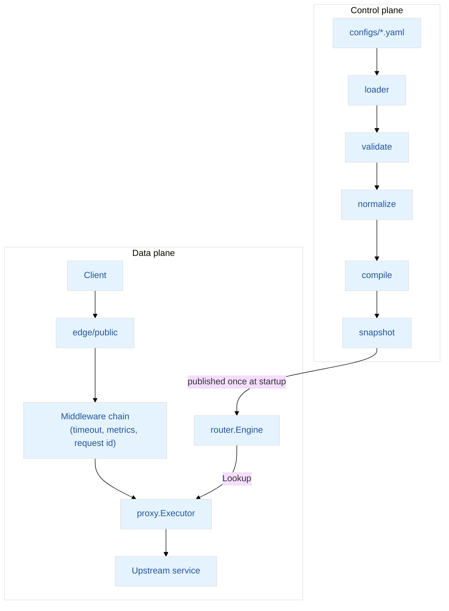
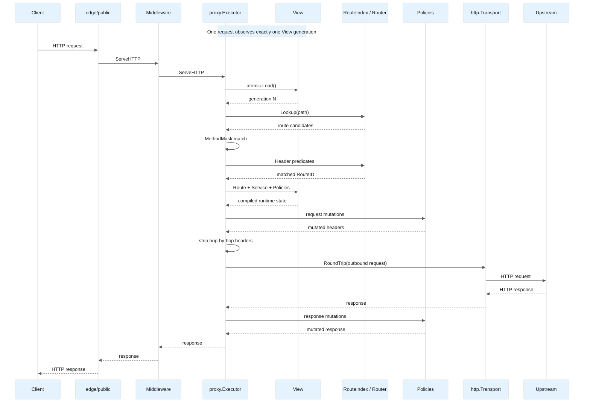
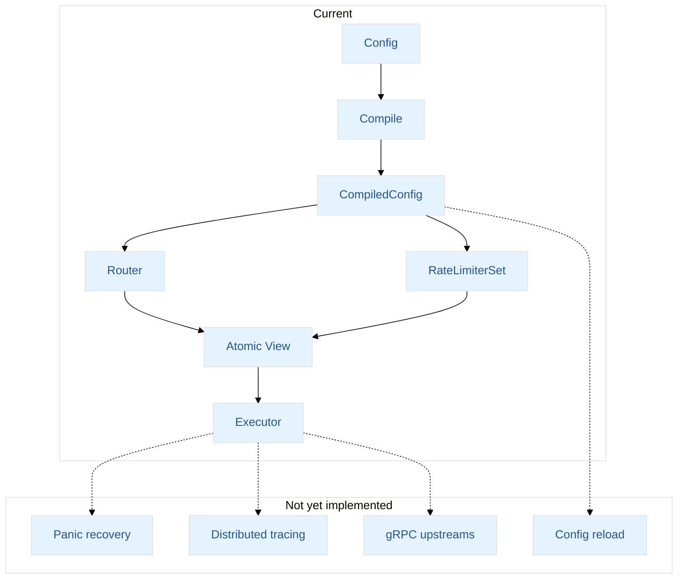

# Architecture

## Overview

Aegis is split into two planes with a hard boundary between them:

- **Control plane** — loads YAML configuration, validates it, normalizes it, and compiles it into an immutable snapshot. This runs at startup (and on reload), never on the request path.
- **Data plane** — serves live HTTP traffic against the compiled snapshot: route lookup, method/header matching, policy mutation, and proxying to upstream services.

The boundary exists so the hot path never re-derives behavior from raw configuration. Every request touches only precompiled, read-only structures — no YAML parsing, no validation, no config-shaped branching at request time.

## Request lifecycle

1. `edge/public` accepts the connection and forwards to the data plane's compiled `http.Handler`.
2. The middleware chain runs outermost first: **timeout**, **metrics**, and **request ID**, which keeps a well-formed client `X-Request-ID` or generates a UUIDv7 and echoes it in the response. The route handler forwards the request to the executor. Panic recovery is not yet part of the chain (see Roadmap).
3. `proxy.Executor` looks up the request path in the route index (`router.Engine.Lookup` over `snapshot.RouteIndex`), producing all route candidates that share that path.
4. Candidates are filtered by HTTP method using a precomputed bitmask (`internal/httpmethod`) and by header predicates (`router.HeadersMatch`). The first candidate satisfying both wins.
5. `policy.ExecuteMutations` applies configured header mutations to the outbound request, then hop-by-hop headers are stripped (`request.RemoveHopHeaders`).
6. The request is forwarded via the configured `http.RoundTripper`. On success, response headers are copied back, response-side policy mutations are applied, and the body is streamed to the client with `io.Copy`.
7. Failure modes are explicit. Every status code the executor can return, and the condition that produces it, is listed in [docs/routing-and-errors.md](docs/routing-and-errors.md) §2.

The sequence below traces one request end to end, including where the atomically published `View` is read and which component performs each mutation.

## Key design decisions

**Radix trie routing, not a map.** Route lookup uses a compressed radix trie supporting static, `:param`, and `*wildcard` segments, matched with static > param > wildcard priority. Lookups perform **zero allocations** across 16 to 32,768 routes, and the tree stays shallow because of prefix compression, so lookup cost grows with path depth, not route count. Insertion (setup-time only) favors correctness over allocation avoidance; lookup (request-time) is optimized for zero allocations, since it runs on every request.

**Method matching via bitmask, not string comparison.** `internal/httpmethod` maps each HTTP method to a bit; route admission is a single `AND` against a precomputed mask instead of iterating and string-comparing allowed methods per request.

**Control/data plane separation.** Configuration compiles once into a `snapshot` package the data plane only reads. This means adding a route, a policy, or a service doesn't change data-plane code paths — it changes what the compiler produces, keeping the request-serving code free of configuration-shaped conditionals.

**Middleware as `func(http.Handler) http.Handler`.** Standard, composable Go idiom. The public server composes the chain in `internal/edge/public/server.go`; the innermost handler forwards each request to the executor.

**Request ID: accepted when well-formed, otherwise a UUIDv7.** A client-supplied `X-Request-ID` is kept only when it is a single value of 1–128 visible ASCII characters, so a caller's ID can be followed end to end while spaces and control characters — the log-injection vector — never get through. Anything else is replaced with a UUIDv7, which is time-ordered and sorts naturally in logs, unlike UUIDv4. The ID is written into the request headers, which is how it reaches the upstream and later handlers without a `context.Context` allocation, and is echoed in the response.

**Separate system and public listeners.** Health and metrics are served on a distinct port (`:18080`) from user traffic (`:8080`), so operational endpoints are never reachable through the same routing/policy path as untrusted traffic.

## Package layout

| Package | Responsibility |
|---|---|
| `internal/app` | Process wiring: dependency container, lifecycle, graceful shutdown |
| `internal/config` | Runtime configuration: flag and environment resolution, strict YAML decoding |
| `internal/httpmethod` | HTTP method set and bitmask, shared by validation, the compiler, and the router |
| `internal/controlplane` | Load → validate → normalize → compile pipeline. Subpackages: `schema` (source model), `loader`, `validate`, `normalize`, `ir`, `compile`, `pipeline` |
| `internal/snapshot` | Immutable compiled data contract, including `RouteIndex` |
| `internal/dataplane/router` | `Engine` façade over the compiled snapshot; header predicate matching |
| `internal/dataplane/proxy` | `Executor`, the terminal handler that performs the upstream call |
| `internal/dataplane/policy` | Header mutation execution and rate limiting |
| `internal/dataplane/request` | Path canonicalization and hop-by-hop header handling |
| `internal/dataplane/retry` | Retries of idempotent upstream requests |
| `internal/dataplane/routelabel` | Route label carried from the executor to the metrics middleware |
| `internal/dataplane/middleware` | Request ID, metrics, and timeout middleware |
| `internal/edge` | Listener-facing HTTP servers: public traffic and admin endpoints |
| `internal/observe` | Health checks and Prometheus metrics registration |

## Roadmap / known limitations

This is a pre-1.0 project. The following items are not implemented; they are deferred deliberately:

- **Panic recovery.** No recovery middleware is part of the public chain, so a panic in a handler is not converted to a 500 response.
- **Distributed tracing.** It requires an OpenTelemetry dependency, an exporter, and context propagation into the executor, which is not justified before the gateway has more than one hop worth tracing.
- **gRPC upstreams.** Not supported; the executor proxies HTTP only.
- **Configuration reload.** Not supported; changing routes requires a restart (see [docs/routing.md](docs/routing.md)).

Request timeouts, request IDs, and metrics with route labels are implemented and wired into the public server.

The diagram below places these items against the implemented pipeline.

Config schemas and public interfaces may change before an initial stable release.
